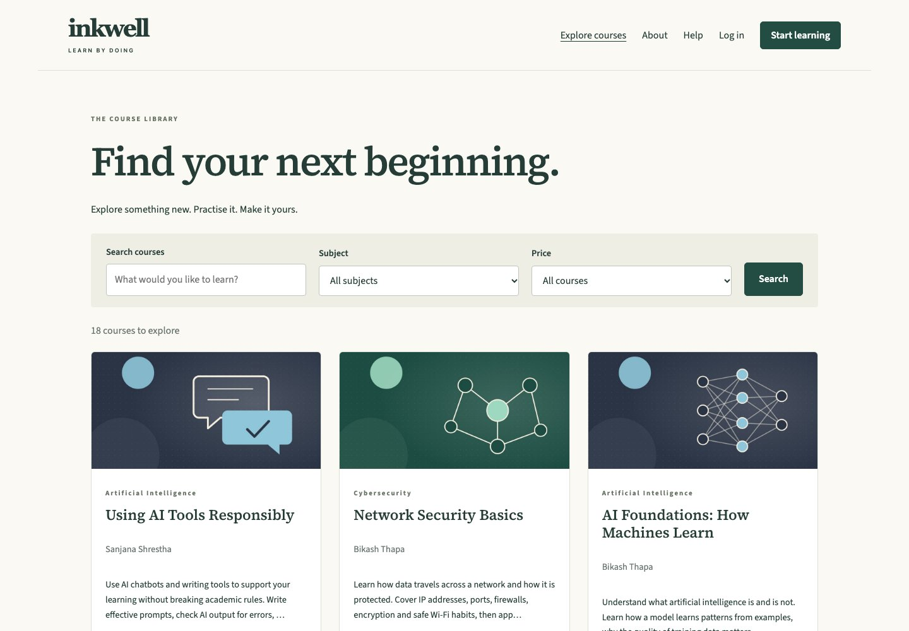

# Inkwell — Django + React learning platform

The backend uses **Python, Django 5.2, Django REST Framework and PostgreSQL**. The frontend uses **React and Vite**, with session Context and local component state. There is no Redux, repository layer, microservice or custom password hashing.

Inkwell is a learning platform with public courses, learner practice activities, a lecturer authoring workspace and administrator tools. It is also a readable example of a Django monolith with a separate React frontend.



[Feature screenshots](docs/SCREENSHOTS.md) · [Docker walkthrough](docs/DOCKER.md) · [Run without Docker](docs/LOCAL_SETUP.md) · [Architecture](docs/ARCHITECTURE.md)

## Get the code

Install [Git](https://git-scm.com/downloads) and [Docker Desktop](https://www.docker.com/products/docker-desktop/) (Windows/macOS), or Docker Engine with the Compose plugin (Linux). Start Docker before continuing. Docker supplies Python, Node and PostgreSQL; you do not need to install them separately for this route.

```bash
git clone https://github.com/hell-driver-ujwal/Inkwell_learning_platform-.git inkwell
cd inkwell
```

Alternatively, choose **Code → Download ZIP** on GitHub, extract the archive, and open a terminal in the extracted folder containing `compose.yaml`. The following commands work in PowerShell, macOS Terminal and a Linux shell.

## First run with Docker

Run each command in order from the repository root:

```bash
docker compose build
docker compose up -d db --wait
docker compose run --rm backend python manage.py migrate
docker compose run --rm backend python manage.py import_legacy_demo --media-source /app/data/demo_media
docker compose up -d backend frontend
```

Open **http://127.0.0.1:5174**. The first build can take several minutes. If the page is not ready yet, inspect `docker compose logs --tail=50 backend frontend`.

The import creates synthetic demo accounts/content and copies bundled media into private storage. Run it **once on an empty database**. No original ASP.NET checkout, pre-existing database, private download or machine-specific path is required. To start without demo content, skip the import and create a maintenance account with `docker compose run --rm backend python manage.py createsuperuser`. This creates an active platform Admin account as well as a Django maintenance superuser.

For later sessions:

```bash
docker compose up -d       # Start the existing application
docker compose stop        # Stop without deleting database records
```

Database records persist in a Docker volume. Uploads persist in `backend/private_media/`. Do not use `docker compose down -v` unless you intend to delete the Docker database. This is a **local development configuration**, with demo credentials and Django/Vite development servers; it is not a production deployment recipe.

See [DOCKER.md](docs/DOCKER.md) for an explanation of each step, updates, troubleshooting and tests. Prefer to install the tools yourself? Follow [LOCAL_SETUP.md](docs/LOCAL_SETUP.md).

## Demo accounts

All imported demonstration accounts use **Password123**. These are synthetic teaching accounts. Select the matching login portal.

| Portal | Email | Useful behavior |
| --- | --- | --- |
| Learner | anita.karki@inkwell.test | Existing progress, paid JavaScript access and completed-course certificate |
| Learner | ben.lee@inkwell.test | Purchase a paid course through the local demo checkout |
| Lecturer | asha.sharma@inkwell.test | Owns HTML/CSS, JavaScript and Digital Safety courses |
| Lecturer | ravi.thapa@inkwell.test | Pending application; cannot log in until approved |
| Administrator | admin@inkwell.test | Account review, oversight, FAQs, subjects, receipts and analytics |

Demo payment: use a ten-digit number beginning with 97 or 98, such as `9841234567`. The verification code is its last four digits: `4567`. Three incorrect codes fail the payment. This is a local simulation and never transfers money.

## Architecture

Follow one request through the application:

1. A React page calls an API function.
2. `frontend/src/api/client.js` sends the session cookie and CSRF token, and translates errors into useful messages.
3. A DRF view applies permission checks and asks a serializer to validate request data.
4. A service carries out a business action, such as enrollment or quiz submission.
5. Django's ORM reads/writes PostgreSQL. Related changes use a transaction.
6. A serializer returns an explicit representation to React.

A **model** describes stored data. A **serializer** validates input and shapes output. A **view** coordinates HTTP requests. A **service** implements a business action. A **selector** assembles a more complicated read. Simple queries remain in the view when another layer would add little value.

Read [ARCHITECTURE.md](docs/ARCHITECTURE.md), [PROJECT_STRUCTURE.md](docs/PROJECT_STRUCTURE.md), and [FEATURE_MAP.md](docs/FEATURE_MAP.md) for the source-to-rewrite mapping.

## Django apps and important models

| App | Responsibility | Important models |
| --- | --- | --- |
| accounts | Email authentication, approval, roles, lockout, profiles, temporary passwords | User, UserRole, AccountStatus |
| courses | Catalogue, ownership, topics, lessons, publication and media | Subject, Course, Topic, Material |
| learning | Enrollment, lesson completion, bookmarks, reviews, calculated progress/certificates | Enrollment, Completion, Bookmark, Review |
| activities | Curriculum activity metadata, server play sessions and private history | Activity, Attempt, PlaySession |
| quizzes | Weighted questions, options, answer validation and review | Question, Option, Answer |
| assessments | Confidence statements, ratings and feedback | Statement, Response |
| games | Eight game templates, items, groups, validation and scoring | GameTemplate, Group, Item |
| scenarios | Branch graph, validated movement, endings and images | Step, Choice |
| discussions | Prompt responses, one-level replies, closure and moderation | Post |
| payments | Local eSewa checkout, verification, immutable receipts | Payment |
| support | Audience-specific FAQ, CAPTCHA and contact inbox | FAQ, ContactMessage |
| analytics | Anonymous page counts and role-scoped dashboards | PageView |

`activities` shares placement and attempt infrastructure. It does **not** merge quizzes, games and scenarios into one generic scoring algorithm. Domain algorithms live in their respective apps.

Foreign keys have descriptive names. Uniqueness constraints prevent duplicate enrollment, completion, bookmarks, answers and reviews. Check constraints protect price consistency, rating/score ranges, user roles/statuses, scenario self-links and verified completed payments. Foreign keys are indexed by Django; additional indexes support history and catalogue queries.

## Authentication and permissions

The custom user model is created in the first migration. Email is case-insensitively unique. `UserRole` contains Learner, Teacher and Admin; Teacher is displayed as Lecturer. `AccountStatus` contains Active, Pending, Rejected and Deactivated.

`GET /api/auth/session/` obtains the session user and CSRF token. Login rotates the session/CSRF token using Django's authentication system. Login and registration enforce CSRF even for anonymous users. Passwords use Django's built-in hashers and validators. Five failed passwords lock an account for fifteen minutes; a correct password at the wrong portal does not count as a failed password. Temporary-password users must change their password before business endpoints allow access.

Reusable role permissions live in `accounts/permissions.py`. Course ownership, preview and study rules live in `courses/permissions.py`. Activity and result access have their own domain checks. Services repeat critical authorization at the transaction boundary where necessary; React visibility is never the security boundary.

- Authors can edit their own courses; an admin's oversight access does not grant unrestricted author editing.
- Administrators can unpublish or delete eligible content, review applications and manage non-admin accounts.
- Paid enrollment requires a completed, verified receipt. A payment and its enrollment commit together.
- Previews never create learner attempts or progress.
- Private media is served through authorized endpoints. There is no public `/media/` route.
- Correct quiz options are not sent before submission.
- Attempt history is limited to its learner, the course author and administrators.
- Structural activity content locks after the first submitted attempt.
- Leaving a course removes enrollment only; history and completion survive re-enrollment.

Django's maintenance admin at `/django-admin/` is read-only for domain records. This prevents bypassing service rules. Use React's administrator/author screens for normal changes. A maintenance superuser can be created with `python manage.py createsuperuser`; imported platform administrators are not automatically Django staff/superusers.

## API structure

All application endpoints begin with `/api/`. DRF list responses use `{count, next, previous, results}` with 24 records per page. API errors use `{errors: ...}`. Normal validation failures return 400, access failures 403, and missing/private scoped records 404.

| Namespace | Examples |
| --- | --- |
| Session | `auth/session/`, `auth/login/`, `auth/register/`, `auth/logout/`, `auth/profile/`, `auth/password/` |
| Public catalogue | `subjects/`, `courses/?search=python&subject=1`, `courses/{id}/` |
| Protected content | `materials/{id}/`, `materials/{id}/file/`, `materials/{id}/captions/` |
| Learning | `courses/{id}/enrollment/`, `materials/{id}/complete/`, `materials/{id}/bookmark/`, `courses/{id}/review/`, `courses/{id}/certificate/` |
| Activities | `activities/{id}/`, `activities/{id}/start/`, `activities/{id}/submit/`, `activities/{id}/move/` |
| History | `attempts/`, `attempts/{id}/`, `attempts/summary/`, `attempts/filters/` |
| Discussion | `posts/?activity={id}`, `posts/{id}/` |
| Payments | `payments/checkout/`, `payments/{id}/verify/`, `payments/{id}/cancel/` |
| Authoring | `author/courses/`, `author/topics/`, `author/materials/`, `author/activities/`, `author/activities/{id}/content/` |
| Administration | `admin/users/`, `admin/subjects/`, `admin/courses/`, `admin/activities/`, `admin/messages/`, `admin/faqs/`, `admin/payments/`, `admin/analytics/` |
| Support/dashboard | `faqs/`, `captcha/`, `contact/`, `dashboard/`, `page-views/` |

Example: quiz start returns a server-issued run UUID and start time. Submit that UUID with `answers: [{question_id, option_id}]`. The backend checks ownership, enrollment, content revision, the timer (including the original thirty-second grace period), attempt limit and option membership before saving score and answers. Repeating a completed submission returns its original result.

## React structure

- `api/`: HTTP configuration and domain request functions.
- `context/`: shared authenticated-user session.
- `hooks/`: request loading/error lifecycle.
- `components/`: reusable form fields, feedback and course cards.
- `layouts/`: navigation, keyboard shortcuts and page frame.
- `pages/public/`: catalogue, course introduction, authentication, help and contact.
- `pages/learner/`: dashboard, lesson/activity reading, history, payment, profile and certificate screens.
- `pages/teacher/`: course studio and focused lesson/activity editors.
- `pages/admin/`: account management and content oversight.
- `features/`: smaller domain components such as quiz playing, scenario editing and course curriculum.
- `styles/`: responsive presentation, keyboard focus and print styling.

`App.jsx` defines routes. It does not contain page business logic. Code labs use a sandboxed iframe; lesson Markdown does not execute embedded HTML. Forms have visible labels and native validation in addition to backend validation. Captions, keyboard controls, skip links, reduced-motion behavior and printable certificates are included.

## Installation choices

| Route | Install on your computer | Guide |
| --- | --- | --- |
| Docker (recommended first run) | Git and Docker with Compose | [Docker walkthrough](docs/DOCKER.md) |
| Native development | Python 3.14, Node.js 24 and PostgreSQL 17 | [Local setup](docs/LOCAL_SETUP.md) |

Dependencies are pinned in Python requirements and the npm lockfile. `.env.example` documents environment variables; Django does not automatically load `.env` files. The Docker guide does not require creating one because Compose supplies development settings explicitly.

## Data migration and media

`data/legacy_seed.json` is a reviewed extraction of the original `Database/CreateDatabase.sql`. It contains the final reproducible demo baseline: 12 users, 8 subjects, 19 courses, 43 topics, 72 materials, 73 activities, 72 quiz questions, 288 options, 205 game items and the supplied history. All original fixed IDs and relationships are retained; PostgreSQL sequences are reset afterward.

The extraction script **does not execute SQL**. It understands literal `INSERT ... VALUES` rows and the seed's relative date expressions. Unknown expressions fail. To reproduce the snapshot:

```bash
python scripts/extract_legacy_seed.py /path/to/LearningSystem/Database/CreateDatabase.sql data/legacy_seed.json --date 2026-10-04
```

Demo passwords are rehashed through Django using the documented demo password; legacy password hashes are not copied into Django's password field. The import command copies the bundled `data/demo_media/Uploads/` into private media storage when passed `--media-source /app/data/demo_media` in Docker (or `--media-source ../data/demo_media` from `backend/` without Docker). Public fonts and the captioned introduction video are bundled in `frontend/public/` with the font licenses.

**Data boundary:** the `.mdf` files have not been opened or exported. They may contain changes beyond the reproducible SQL seed. Optional presentation seed scripts are not automatically applied because they may duplicate or extend the baseline; they need comparison with a SQL Server export. See [MIGRATION_NOTES.md](docs/MIGRATION_NOTES.md).

Run `python manage.py audit_media` to report missing or unreferenced files. File replacement/deletion retains old files for a separate storage cleanup review; it never deletes a shared seed asset prematurely.

## Testing and quality checks

Application verification on 5 October 2026: **72 backend tests passed locally and in Docker**, PostgreSQL migrations applied, Django checks clean, Ruff/ESLint passed, and both frontend production builds passed. See [VERIFICATION.md](docs/VERIFICATION.md) for scope and limitations.

With Docker services running, run checks from the repository root:

```bash
docker compose exec backend python manage.py check
docker compose exec backend python manage.py test --noinput
docker compose exec backend python manage.py makemigrations --check --dry-run
docker compose exec frontend npm run lint
docker compose exec frontend npm run build
```

Native commands are in [LOCAL_SETUP.md](docs/LOCAL_SETUP.md#testing).

Tests use PostgreSQL, including its constraints and transactions. The database user needs permission to create the temporary `test_inkwell` database. Tests cover role/ownership restrictions, CSRF, lockout, forced password change, paid enrollment, progress, certificates, quiz scoring/timers/limits, all eight game scores, scenario traversal, discussion moderation, upload protection, payment idempotency and authoring/deletion rollback.

The frontend build checks module compilation. Browser smoke checks are documented separately; a successful build alone is not a claim that every browser workflow has been exhaustively tested. See [VERIFICATION.md](docs/VERIFICATION.md) for the final recorded results.

## Decisions and known boundaries

- This is a medium-sized Django monolith with domain apps, not a literal translation of SQL Server helper classes.
- Progress is calculated from published content and recorded completions/attempts/posts; it is not stored in a second counter that can drift.
- PostgreSQL row locks serialize critical workflows. Code comments explain why transactions exist.
- Discussion replies remain one level deep. Administrators may moderate another author's course but only post in their own authored courses.
- Memory retains the source's reported-move scoring model; flashcards remain self-rated. These are learning games, not an anti-cheat examination system.
- The UI is a responsive React rebuild. It preserves the workflows and content rather than reproducing every Web Forms layout pixel.
- Email replies open the administrator's email client, matching the original contact-inbox behavior. The app does not silently send mail.
- This is a local development delivery. No production hosting, real eSewa integration, SQL Server live export or production security review has been performed.

## What to study first

1. Read `accounts/models.py` and `courses/models.py`: fields, foreign keys, choices and constraints.
2. Follow enrollment from `CourseDetailPage.jsx` → `api/courses.js` → `learning/views.py` → `learning/services.py`.
3. Read `courses/permissions.py` and the access tests to understand why UI hiding is insufficient.
4. Read `quizzes/scoring.py` beside its tests; this is a small, pure business algorithm.
5. Study serializers, then the authoring views. Notice how views delegate workflows.
6. Finally study `activities/services.py` and `payments/services.py`: transactions, row locks and idempotency.
