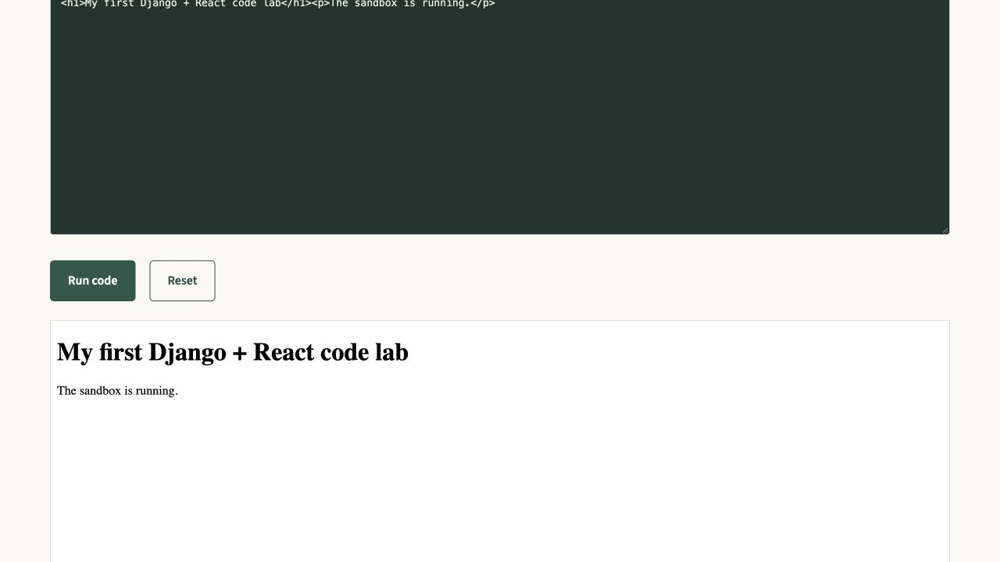

# Verification record

Recorded **5 October 2026 (Asia/Kathmandu)**. This distinguishes tested behavior from remaining migration boundaries.

## Executed checks

| Check | Result |
| --- | --- |
| Original ASP.NET project | Used read-only; rebuild lives in a separate directory |
| Local PostgreSQL 17 schema migrations | Applied successfully |
| Docker PostgreSQL 17 schema migrations | Applied successfully to a separate fresh database |
| Portable seed import | Imported 12 users, 19 courses, 72 materials, 73 activities and supplied related content/history in both environments |
| Django `check` | No issues locally and in Docker |
| Django `test --noinput` | **72 passed locally; 72 passed inside Docker** |
| `makemigrations --check --dry-run` | No changes detected |
| `migrate --check` | No unapplied migrations |
| Ruff lint | Passed |
| Ruff format | 130 Python files already formatted |
| Frontend ESLint | Passed locally and inside Docker |
| Frontend Prettier | Passed locally |
| Frontend Vite production build | Passed locally and inside Docker; 262 modules transformed |
| Published imported activity validation | Every published activity passed its quiz/game/assessment/scenario/discussion publication checks |
| Media audit | 44 referenced paths, **0 missing**, 5 unreferenced retained images |
| Docker Compose configuration | Valid |
| Docker image builds | Backend and frontend built successfully |
| Docker running services | `db` healthy; backend and frontend running |
| HTTP smoke through Docker frontend | CSRF-protected login 200, authenticated dashboard 200, catalogue 18 published courses |
| Docker session separation | Distinct session/CSRF cookie names confirmed |

The npm install reported zero known vulnerabilities at installation time. ESLint 9 is retained for compatibility with eslint-plugin-react 7's declared peer range; it is a development tool, not a runtime dependency. This is not a substitute for a production dependency/security review.

## What the tests cover

- Role portals, active/pending accounts, case-insensitive email uniqueness, lockout, CSRF, forced password change and administrator peer restrictions.
- Author ownership, draft/public/preview access, paid enrollment, leaving/rejoining, completion/progress and certificate eligibility.
- Quiz weighted scoring, invalid options, timer expiry, server-owned runs, attempt limits, repeated submission and hidden answer keys.
- Each of the eight game scoring rules and invalid answer shapes.
- Confidence ratings and feedback.
- Scenario choice ownership, stale step versions, preview behavior, exactly-once endings and preserving images during graph edits.
- Discussion ownership, reply scope, closure and moderation.
- Payment failure counters, verification, idempotency, cancellation and enrollment integrity.
- Authoring rollback, structural content locks, title-only changes, deletion protections and cross-owner injection.
- Private uploads, signatures, captions, authorized media ranges and same-origin PDF embedding.
- Result summary privacy and public crawler discovery.
- An integrated API journey: author creates a course/topic/lesson, publishes, learner enrolls/completes, then earns a certificate.

Tests use PostgreSQL rather than substituting SQLite. A successful test suite is evidence for these assertions, not proof against every possible concurrent race or UI regression.

## Browser smoke checks

Inspected the responsive home/catalogue, imported learner login, course outline and progress, certificate page, Code Lab editing/execution/reset, quiz introduction/settings, and learner result history. The Code Lab test changed only the browser's local editor state and restored the example afterward; no original lesson was overwritten.

Author/admin authorization and creation workflows have API coverage. Exhaustive click-through testing of every author/admin form, every game interaction and every responsive breakpoint is not complete. No formal screen-reader audit was performed.

## Readability review

Checked Python AST/token structure, imports, file sizes and source formatting. No wildcard imports, semicolon-compressed Python statements or Python functions over 90 lines were found in application source. The largest backend module is the explicit 329-line import mapping; the largest React page is 236 lines. Views remain small request coordinators. Game and scenario algorithms remain distinct, and the HTTP configuration is centralized.

## Remaining boundaries

The SQL Server MDF/LDF files have not been exported. Optional presentation seed/history extensions are not merged. Therefore full parity with unknown live database changes is **not claimed**. See MIGRATION_NOTES.md for the reproducible baseline and a safe extension strategy.

React reproduces workflows with a rebuilt layout; it does not reproduce every original pixel or all public explanatory copy verbatim. Backend robots/sitemap discovery exists, but the application is client-rendered. The payment gateway remains the original-style local demonstration, not a real financial integration. Production deployment and a production security audit are outside this local development verification.

## Current local addresses

- Existing host-process frontend: `http://127.0.0.1:5173` while its process runs.
- Docker frontend: `http://127.0.0.1:5174` while Compose runs.
- Docker backend API: `http://127.0.0.1:8001/api/`.

The local and Docker databases are separate. The private media folder is shared from the workspace. `docs/DOCKER.md` explains startup, migration, seed import, logs, testing and safe shutdown.
